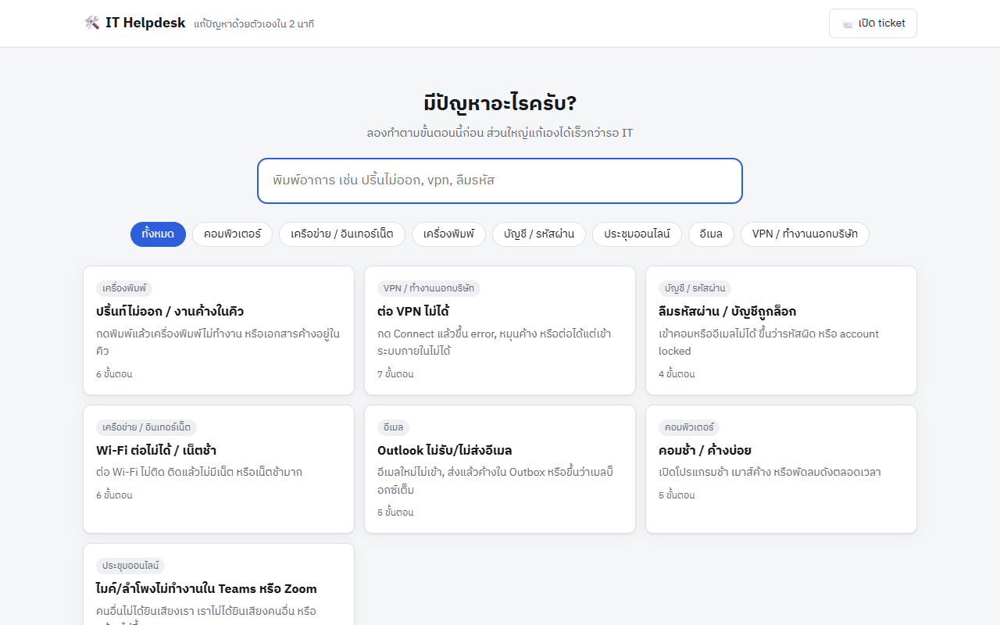
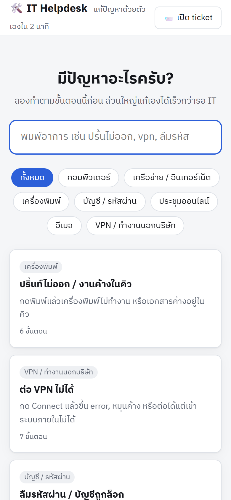

<div align="center">


<br>


</div>

## Overview

ระบบศูนย์รวมขั้นตอนแก้ไขปัญหาไอทีเบื้องต้นสำหรับผู้ใช้งาน ช่วยให้ผู้ใช้สามารถแก้ไขปัญหาที่พบบ่อยได้ด้วยตนเองก่อนยื่นคำร้อง (ticket) เช่น เครื่องพิมพ์ค้าง การเชื่อมต่อ VPN และการรีเซ็ตรหัสผ่าน เพื่อลดภาระงานซ้ำของฝ่ายสนับสนุน

*A self-service knowledge base of IT troubleshooting runbooks that lets employees resolve common issues before opening a ticket.*

<table>
<tr>
<td width="72%"></td>
<td width="28%"></td>
</tr>
<tr><td align="center"><sub>หน้าจอคอมพิวเตอร์ (ข้อมูลตัวอย่าง)</sub></td><td align="center"><sub>หน้าจอโทรศัพท์มือถือ</sub></td></tr>
</table>

## Key Features

- **การค้นหาด้วยภาษาธรรมชาติ** — ค้นจากหัวข้อ คำสำคัญ อาการ และขั้นตอน เช่น "ปริ้นไม่ออก" หรือ "vpn"
- **ขั้นตอนแบบตรวจสอบได้** — ผู้ใช้ทำเครื่องหมายขั้นตอนที่ดำเนินการแล้ว
- **การส่งต่อคำร้อง** — หากยังแก้ไขไม่ได้ ระบบแจ้งข้อมูลที่ต้องแนบ และนำไปยังช่องทางยื่นคำร้อง
- **สถิติสำหรับผู้ดูแลระบบ** — แสดงหัวข้อที่ยังแก้ปัญหาไม่สำเร็จ และจำนวนคำร้องที่ลดลง เพื่อใช้ปรับปรุงเนื้อหาและรายงานผล
- **การจัดการเนื้อหา** — เพิ่มหรือแก้ไขขั้นตอนได้จากหน้าเว็บในโหมดผู้ดูแลระบบ (มีตัวอย่าง 7 หัวข้อ)

## Tech Stack

- Node.js (ES Modules) · Vercel Serverless Functions
- Upstash Redis (ฐานข้อมูล) · HTML / CSS / JavaScript (ไม่ใช้ framework)

## Getting Started

```bash
npm install
cp .env.example .env
npm run dev            # http://localhost:3000
```

หากยังไม่ได้กำหนดฐานข้อมูล ระบบจะจัดเก็บข้อมูลเป็นไฟล์ภายในโฟลเดอร์ `.data/` สำหรับการทดสอบในเครื่อง

## Configuration

| Variable | Description |
|---|---|
| `ADMIN_KEY` | รหัสผู้ดูแลระบบ สำหรับแก้ไขเนื้อหาและดูสถิติ (จำเป็น) |
| `KV_REST_API_URL`, `KV_REST_API_TOKEN` | การเชื่อมต่อ Upstash Redis (กำหนดอัตโนมัติเมื่อติดตั้งผ่าน Vercel Marketplace) |
| `ORG_NAME` | ชื่อหน่วยงานที่แสดงบนหน้าเว็บ |
| `TICKET_URL` | ลิงก์ระบบยื่นคำร้อง (helpdesk, Google Form หรือ LINE OA) |
| `IT_CONTACT` | ข้อความช่องทางติดต่อฝ่ายไอทีท้ายหน้า |

## Deployment (Vercel)

1. นำเข้าโปรเจกต์จาก GitHub ใน Vercel
2. เพิ่มฐานข้อมูล **Upstash Redis** ในเมนู Storage
3. กำหนดค่า `ADMIN_KEY`, `ORG_NAME`, `TICKET_URL` และ `IT_CONTACT`
4. Deploy

## Related Projects

[IT Expiry Alert](https://github.com/tanakrthum254614-max/it-expiry-alert) · [IT Asset Tracker](https://github.com/tanakrthum254614-max/it-asset-tracker) — ชุดเครื่องมือสำหรับงานสนับสนุนไอทีภายในองค์กร

---

<div align="center"><sub>Developed by <a href="https://github.com/tanakrthum254614-max">Tan Akrthum</a> · Bangkok, Thailand</sub></div>
